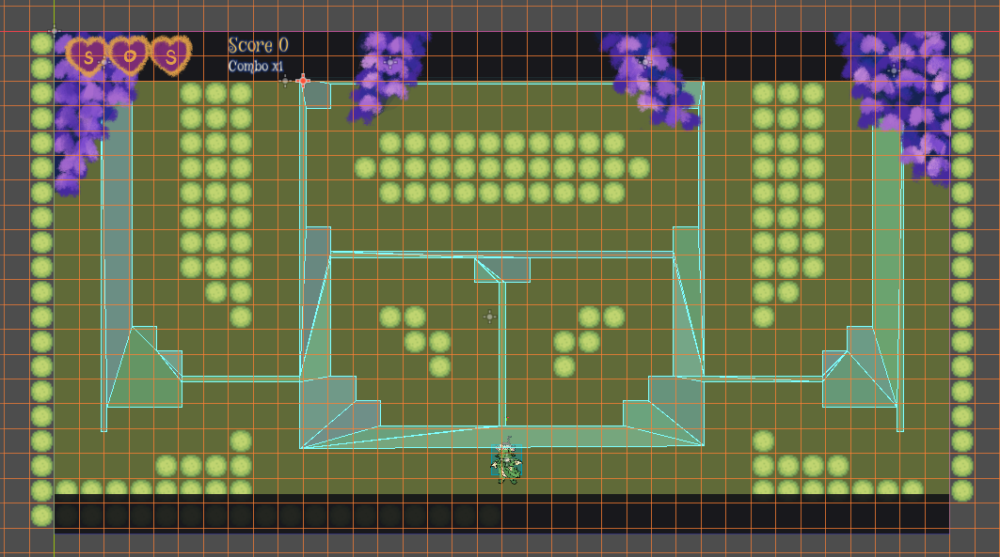
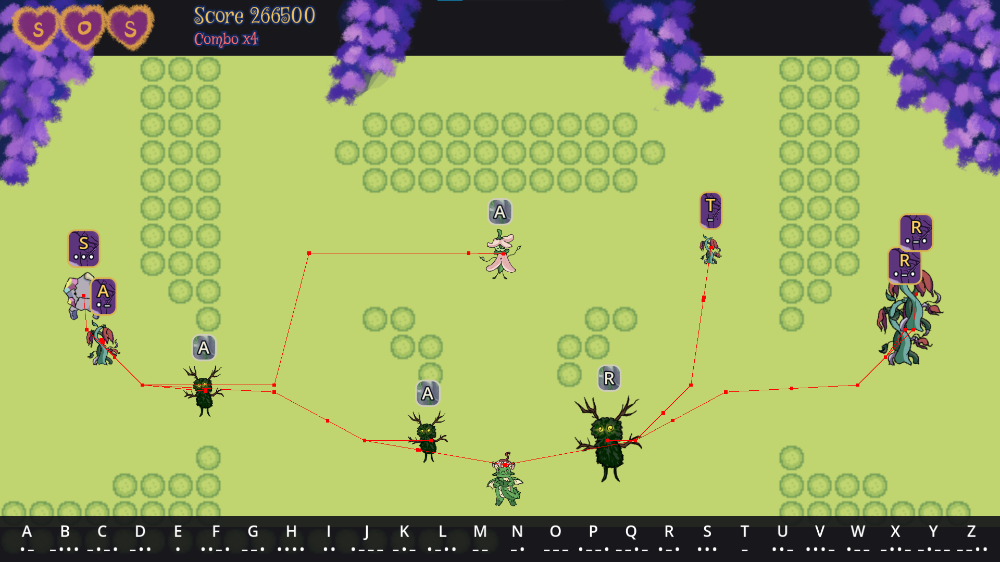

# Sprouts of Safety

`Godot, GDScript, GitHub`

[GitHub](https://github.com/RasheedC131/MorseCodeDefense) | [Devpost](https://devpost.com/software/morse-code-defense)

---

## Overview
Sprouts of Safety is an educational game that teaches you Morse code using your eyes. In this tower defense, you must deploy troops by blinking out the letters of the incoming enemies.

This project was made for Knight Hacks IX, a 36 hour hackathon. Our team tackled the challenge presented by Full Sail, to make a serious game or training simulation using face detection and/or pathfinding, we chose both. I took the charge on pathfinding and agent behavior, as well as assisting our teammates who were new to game development.

---

## Pathfinding and Navmesh
Godot allows you to bake a tileset into a navmesh with it's NavigationRegion2D node. I built out the map using 2 layers: The floor as a Navigation Layer, and the walls as a physics layer.



Using this agents with a NavigationAgent2D node can path find with the algorithm of your choice. I went with A* as we only needed the quickest path to the target.



---

## Balanced Enemy Spawning
Enemies in this game are broken into tier based on the length of their letter code. The shorter being weak but fast, and the long being strong but slow.
```gdscript
const LETTER_TIERS = {
	1: ["E", "T"],
	2: ["A", "I", "M", "N"],
	3: ["D", "G", "K", "O", "R", "S", "U", "W"],
	4: ["B", "C", "F", "H", "J", "L", "P", "Q", "V", "X", "Y", "Z"]
}
```
Due to the way morse code is built, the ratio to weak to strong letters is vastly unbalanced. If you spawned by choosing completely random there is a 46% chance of getting the strongest enemy type, and only an 8% of getting the weakest. To remedy this, I implemented a weighted algorithm. 
* Each tier is assigned a weight, higher numbers being more common.
* The weights are summed, a random number is picked from 0 to the random value.
* You loop around the tiers checking if the random value is lower than the current weight.
* If not the value gets subtracted by the weight and you move onto the next.
* The loop is completed once the value finds a weight higher than it.
  
```gdscript
const TIER_WEIGHTS = {
  1: 17,
	2: 55,
	3: 25,
	4: 3
}

func get_weight_balanced_letter() -> String:
  #Add up weights
  var sum : int = 0
  for weight in TIER_WEIGHTS.values():
    sum += weight
	
  #Pick random 0-sum
  var rand_val = randi() % sum
  var rand_tier = 1
		
  #Find weight lower than random value, 
  #if not subtract weight from value and try again
  for tier in TIER_WEIGHTS:
    var current_weight = TIER_WEIGHTS[tier]
      if rand_val < current_weight:
        rand_tier = tier
        break
      else:
        rand_val -= current_weight
			
    return LETTER_TIERS[rand_tier].pick_random()
```

---

[back](../)
